<div align="center">

<h1><sub>On the Design of Hyper-Connections:</sub><br>Simplification, Stability, and Scalability</h1>

<p>
Xiangdong Zhang, Xiaohan Qin, Sunan Zou, Tuo Dai, Bizhao Shi, Zhuo Xia,<br>
Yebin Yang, Yizhou Chen, Yuliang Liu, Yu Cheng, Junchi Yan
</p>

<p>Dots Studio, Xiaohongshu Inc.</p>

<p>
  <a href="https://arxiv.org/abs/2611.05984"><strong>arXiv</strong></a>
  &nbsp; | &nbsp;
  <a href="paper/SimpleHC.pdf"><strong>Technical Report</strong></a>
  &nbsp; | &nbsp;
  <a href="#citation"><strong>BibTeX</strong></a>
</p>

</div>

Guided by a systematic study of Hyper-Connections, **SimpleHC** redesigns Hyper-Connections by simplifying both the architecture and its execution, making performance gains more accessible and practical at scale.

<p align="center">
  <a href="assets/figure-1.png"><picture>
    <source media="(max-width: 600px)" srcset="assets/figure-1-mobile.png">
    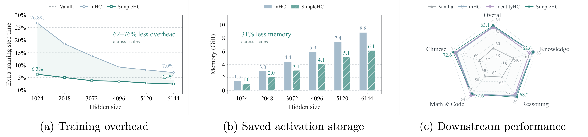
  </picture></a>
</p>

<p align="center">Figure 1 · Lower training overhead, less saved activation storage, competitive quality.</p>

**It maintains performance comparable to mHC on 15B and 30B MoE models with 62–76% less additional training overhead across scales.** It also exhibits smoother training dynamics and remains stable in 230B-A6B stress tests.

## News

- **2026.11** We released the [SimpleHC technical report](https://arxiv.org/abs/2611.05984) on arXiv.
- **2026.09** Our work [xHC](https://github.com/aHapBean/xHC) has been accepted to **NeurIPS 2026**! xHC scales residual streams beyond four through temporal feature augmentation and sparse updates, improving model quality along a complementary scaling axis.

We may release the training code and efficient kernels implemented with [DeepGEMM](https://github.com/deepseek-ai/DeepGEMM) in the next month or two. Star ⭐ this repository to stay updated!

## Overview

Hyper-Connections are increasingly adopted in frontier language models, yet their components remain insufficiently understood and introduce non-negligible training overhead. We systematically study read gates, write gates, and residual mixing to understand which interactions matter and which costs can be avoided.

- **Which interactions matter?** Learned read/write gating without mixing and unconstrained mixing with fixed gates each achieve quality comparable to mHC. Unconstrained mixing improves model quality but carries propagation risks, while Sinkhorn constraints largely eliminate its benefit over identity transitions.
- **Where does the overhead come from?** Repeated access to the expanded residual state remains costly even without mixing, motivating shared memory access across sublayers.

SimpleHC therefore simplifies both the residual architecture and its execution: retain learned read/write gates with identity transitions, and exploit the additive structure and shared gate inputs to reduce repeated state access.

## Method

<p align="center">
  <a href="assets/method.png">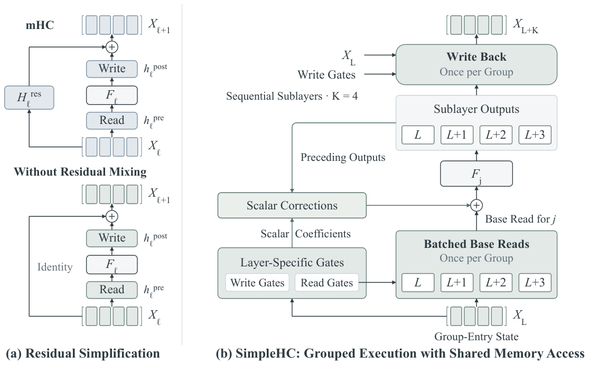</a>
</p>

1. **Simplify the residual structure.** Keep learned read/write gates and replace residual mixing with identity transitions. Residual updates accumulate additively.
2. **Share memory access across sublayers.** Generate separate gates from one group-entry state, batch base reads, and defer writes to the group boundary. Scalar corrections preserve preceding sublayer output contributions.

With four streams and groups of four sublayers, SimpleHC halves logical forward traffic from 18C to 9C relative to fused mHC and identityHC.

<p align="center">
  <a href="assets/memory-access.png">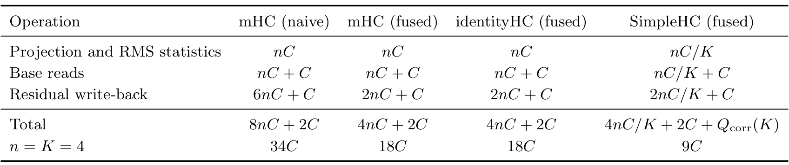</a>
</p>

<p align="center">Table 1 · Logical forward memory access per token per sublayer.</p>

Fused forward and backward kernels reduce intermediate tensors and repeated state accesses.

## Results

### Systematic Study of HC Components

We compare gate conditioning, residual mixing, and fixed-gate controls on 15B-A1B MoE to isolate their contributions.

<p align="center">
  <a href="assets/architecture-study.png">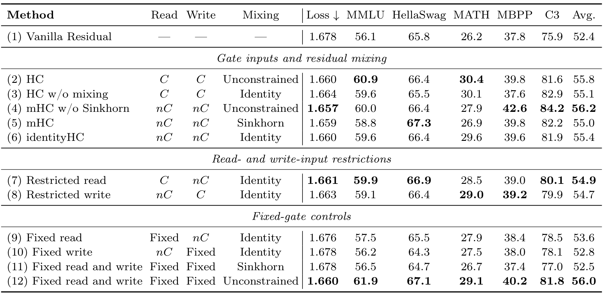</a>
</p>

<p align="center">Table 2 · Disentangling read/write gating and residual mixing.</p>

The average score is 55.4 with learned read/write gates and identity transitions, and 56.0 with unconstrained mixing and fixed gates, compared with 55.0 for mHC. Combining learned gates and unconstrained mixing reaches 56.2, while imposing Sinkhorn constraints limits the gains from mixing.

### Shared Memory Access at 15B Scale

<p align="center">
  <a href="assets/sharing-ablation.png">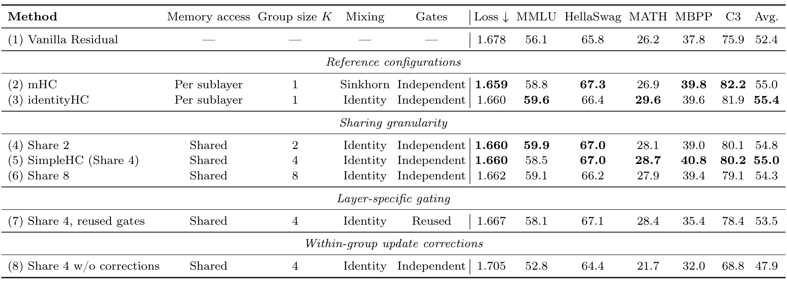</a>
</p>

<p align="center">Table 3 · Sharing granularity, layer-specific gates, and scalar corrections.</p>

Sharing across four sublayers retains competitive quality. Separate gate parameters and scalar corrections are important: reusing gates lowers the average score from 55.0 to 53.5, while removing corrections increases loss from 1.660 to 1.705.


### Competitive Quality at 30B Scale

On 30B-A2B MoE, SimpleHC matches the loss of both mHC and identityHC at 1.561 and achieves an average score of 63.1 across 14 benchmarks, compared with 62.9 for mHC and 62.8 for identityHC.

<p align="center">
  <a href="assets/results-30b.png">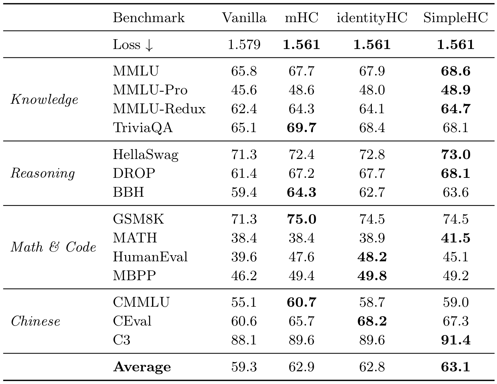</a>
</p>

<p align="center">Table 4 from the technical report · 14 benchmarks</p>

### Lower Training Overhead

<p align="center">
  <a href="assets/efficiency-pair.png"><picture>
    <source media="(max-width: 600px)" srcset="assets/efficiency-pair-mobile.png">
    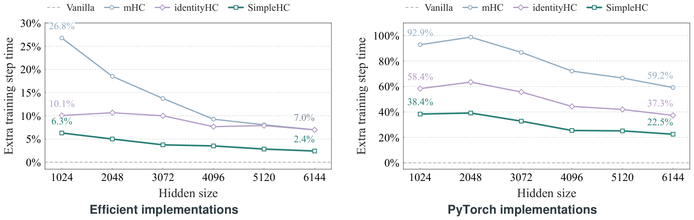
  </picture></a>
</p>

- At C = 6144, SimpleHC adds 2.4% training overhead, versus approximately 7.0% for both baselines, eliminating about two-thirds of the additional overhead.
- With PyTorch implementations, SimpleHC also has the lowest overhead across the tested widths. Specialized kernels reduce its overhead from 22.5% to 2.4% at C = 6144.
- Shared group-entry states reduce estimated saved activation storage within the measured residual and HC operations by approximately 31% relative to mHC.

Measurements use eight-layer models with matched backbone, batch-size, and parallel settings at each width. Overhead is additional end-to-end training-step time relative to the vanilla residual baseline.

### Comparison with xHC

<p align="center">
  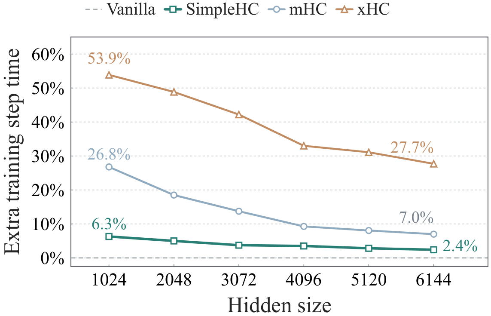
</p>

We also compare with xHC, which explores larger residual-stream capacity. At C = 6144, xHC adds 27.7% training overhead, compared with 2.4% for SimpleHC. xHC uses 16 streams with 4 active streams; mHC and SimpleHC use 4 streams.


## Analysis

### Why Retain Gating Without Mixing?

Learned read/write gating and unconstrained mixing form two effective interaction groups: either alone achieves quality comparable to mHC. Unconstrained mixing can improve quality but risks cumulative signal amplification; Sinkhorn constraints mitigate that risk while limiting its gains. These findings motivate retaining learned gates with identity transitions.

<p align="center">
  <a href="assets/residual-transfer.png">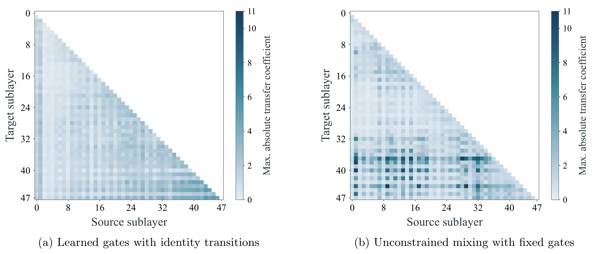</a>
</p>

<p align="center">Figure 7 · Learned read/write gating avoids the larger coefficient peaks observed with unconstrained mixing.</p>

### Why Does Shared Memory Access Work?

Gates differ across sublayers, yet can be predicted from a shared group-entry state. Layer-specific predictors reduce write-gate MAE from 0.0504 to 0.0103, supporting shared inputs with separate gate parameters.

<p align="center">
  <a href="assets/gate-analysis.png"><picture>
    <source media="(max-width: 600px)" srcset="assets/gate-analysis-mobile.png">
    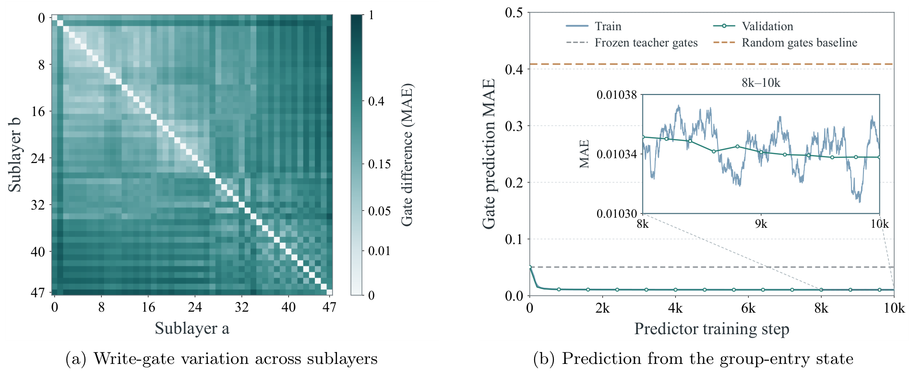
  </picture></a>
</p>

These observations support sharing gate inputs while retaining layer-specific parameters. Scalar corrections separately preserve the sequential output contributions, consistent with the ablations above.

### Does Simplification Compromise Stability?

<p align="center">
  <a href="assets/stability-pair.png"><picture>
    <source media="(max-width: 600px)" srcset="assets/stability-pair-mobile.png">
    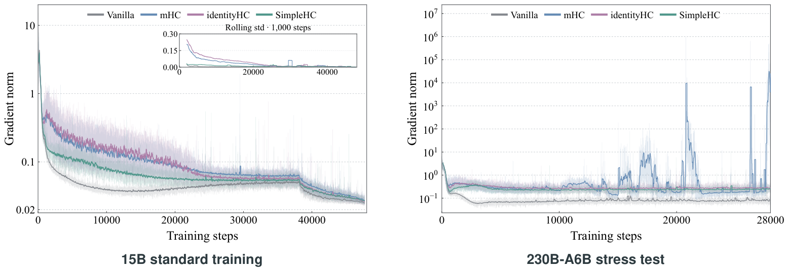
  </picture></a>
</p>

During 15B training, SimpleHC exhibits smaller gradient-norm fluctuations early after warmup; the HC variants reach comparable ranges later. In the 230B-A6B stress test at 10× the reference learning rate, mHC exhibits gradient spikes reaching approximately 1.9 × 10⁶, while SimpleHC and identityHC maintain bounded gradient norms.

## Citation

```bibtex
@misc{zhang2026designhyperconnectionssimplificationstability,
      title={On the Design of Hyper-Connections: Simplification, Stability, and Scalability},
      author={Xiangdong Zhang and Xiaohan Qin and Sunan Zou and Tuo Dai and Bizhao Shi and Zhuo Xia and Yebin Yang and Yizhou Chen and Yuliang Liu and Yu Cheng and Junchi Yan},
      year={2026},
      eprint={2611.05984},
      archivePrefix={arXiv},
      primaryClass={cs.LG},
      url={https://arxiv.org/abs/2611.05984},
}
```

## Contact

For questions about the paper, please contact [zhangxiangdong@sjtu.edu.cn](mailto:zhangxiangdong@sjtu.edu.cn).
